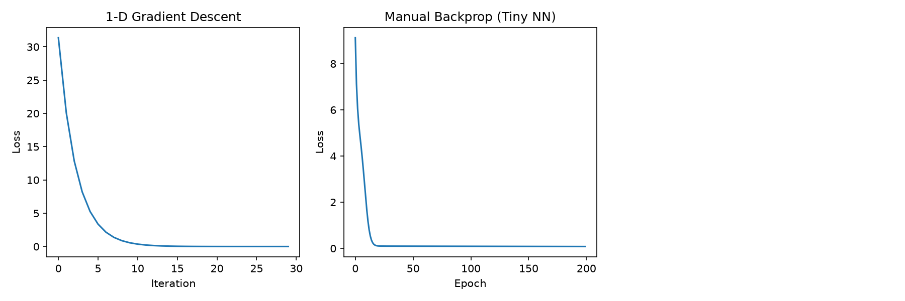

**Gradient Descent Optimization Using Calculus**

**Course:** BACHELOR OF INFORMATION TECHNOLOGY AND COMPUTING (BITC)
**Assignment:** Gradient Descent Optimization Using Calculus
**Group:** Group 1

No.  Name (Registration Number)
1. KISAMBU SHARIF (26/U/ITD/1500/GV)
2. IKIRIA ANGEL GENEVIEVE(26/U/ITE/13249/PE)
3. BAMUWAMYE MELVIN TREVOR (26/U/ITD/1497/GV)
4. ACWAMU ABEL MWEBAZE(26/U/ITE/13160/PE)
5. ASHABA RAYMOND  (25/U/ITD/11239/PD)
6.MUSINGUZI ALLAN(26/U/ITD/13364/PD)


## 1. Overview

This project shows how calculus drives gradient descent, in three stages of increasing complexity:

1. **1-D gradient descent**: minimizing a single-variable function using its derivative.
2. **A tiny neural network with manual back-propagation**: applying the chain rule by hand.
3. **The same network in PyTorch**: using automatic differentiation to confirm the manual result.

## 2. The calculus behind it

Gradient descent minimizes a loss function L by repeatedly stepping against its gradient:

```
w_new = w_old - lr * dL/dw
```

where `lr` is the learning rate (step size).

### 2.1 One-dimensional example

- Loss: `L(w) = (w - 3)^2`
- Derivative: `dL/dw = 2(w - 3)`
- Setting `dL/dw = 0` gives the true minimum at `w = 3`, which we use to check the algorithm.
- Start: `w = 10`, learning rate `0.1`, 30 iterations.

### 2.2 Neural network with manual back-propagation

Architecture: `x -> Linear (1->8) -> ReLU -> Linear (8->1) -> prediction`
Loss: Mean Squared Error, `L = (1/N) * sum((pred - y)^2)`

Using the chain rule, working backwards through the network:

| Quantity | Derivative |
|----------|-----------|
| Output | `dL/dpred = 2(pred - y)/N` |
| Layer 2 weights | `dL/dW2 = a1^T . dL/dpred` |
| Layer 2 bias | `dL/db2 = sum(dL/dpred)` |
| Hidden activation | `dL/da1 = dL/dpred . W2^T` |
| Through ReLU | `dL/dz1 = dL/da1 * 1[z1 > 0]` (ReLU'(z) is 1 for z>0, else 0) |
| Layer 1 weights | `dL/dW1 = X^T . dL/dz1` |
| Layer 1 bias | `dL/db1 = sum(dL/dz1)` |

Every parameter is then updated with `param -= lr * gradient`.

### 2.3 PyTorch (automatic differentiation)

`loss.backward()` computes the same chain-rule gradients automatically, so this section serves as a check on our manual derivation.

## 3. How to run

```bash
git clone https://github.com/kisambusharif-maker/Gradient-Descent-Optimization-BITC1-Group-1
cd Gradient-Descent-Optimization
pip install -r requirements.txt
python GradientDescentGroup1.py
```

The script prints the results and saves the figure to `plots/results.png`. PyTorch is optional; without it, section 3 of the script is skipped.

## 4. Results


| Experiment | Result |
|------------|--------|
| 1-D gradient descent | Final `w ≈ 3.0087` (true minimum is 3), final loss `≈ 7.5e-05` |
| Manual back-propagation | Final MSE `≈ 0.0800` after 200 epochs |
| PyTorch autograd | Final MSE `≈ [fill in after running with PyTorch installed]` |



## 5. Discussion

- **1-D case:** The loss falls smoothly toward zero and `w` converges to the analytical minimum of 3, confirming the update rule.
- **Neural network:** The loss decreases steadily over 200 epochs. It does not reach zero because the data contains noise (`0.3 * randn`), so about `0.09` (the noise variance) is the best achievable error. A final loss of about 0.08 means the model fits the underlying trend `y = 2x + 1` well.
- **Manual vs. PyTorch:** The two losses should be similar but not identical, because the initial weights differ. Agreement in trend supports the correctness of our hand-derived gradients.
- **Learning rate:** [Add your observations here, e.g. what happens with a larger or smaller `lr`.]

## 6. Files

| File | Description |
|------|-------------|
| `GradientDescentGroup1.py` | Main script with all three experiments |
| `requirements.txt` | Python dependencies |
| `plots/results.png` | Loss curves generated by the script |